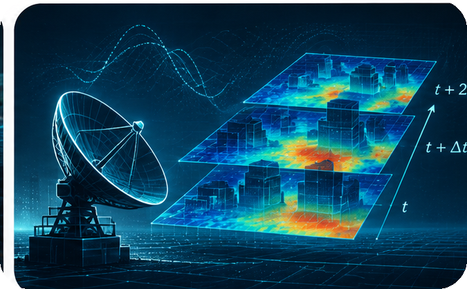
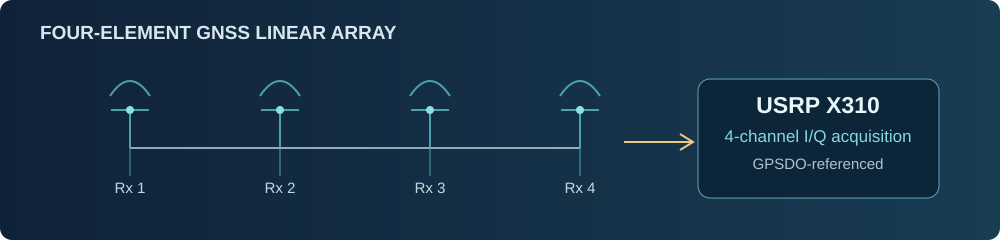

<!-- GitHub Profile README for github.com/Rango-T10000 -->

  

  <h2>Zhicheng Wang</h2>
  
PhD Student · Department of Computing · The Hong Kong Polytechnic University

  

    <a href="https://www.linkedin.com/in/zhicheng-wang-610885282">Linkedin</a> &nbsp;·&nbsp;
    <a href="https://www.researchgate.net/profile/Zhicheng-Wang-47">ResearchGate</a> &nbsp;·&nbsp;
  

---

### Research

My research focuses on **AI-enabled wireless communications** and **wireless spatial intelligence**. I explore how spatial perception and learned radio environment representations can support **wireless channel modeling, prediction, and proactive communications** in mobile and autonomous systems.

**Research interests:** Wireless Spatial Intelligence · Radio Environment Modeling & Prediction · Perception-Assisted Communications

<table>
  <tr>
    <td align="center" width="33.3%">
      
       
      <b>Wireless Spatial Intelligence</b>
    </td>
    <td align="center" width="33.3%">
      
       
      <b>Radio Environment Modeling &amp; Prediction</b>
    </td>
    <td align="center" width="33.3%">
      
       
      <b>Perception-Assisted Communications</b>
    </td>
  </tr>
</table>

### Selected Publications

| Venue | Publication |
|:--|:--|
| **IEEE INFOCOM 2026** · CCF A | **From FSD to FSC: Enabling Full Smart-Communication in Autonomous Vehicles Through Full Self-Driving Models** · *Top Ten Papers* · [Paper](https://research.polyu.edu.hk/en/publications/from-fsd-to-fsc-enabling-full-smart-communication-in-autonomous-v/) |
| **IEEE TMC 2026** · CCF A | **Toward Scalable Reconfigurable Intelligent Surfaces Using Commercial RFIDs** · [Paper](https://doi.org/10.1109/TMC.2026.3674520) |
| **IEEE INFOCOM 2025** · CCF A | **Commercial RFIDs as Reconfigurable Intelligent Surfaces** · [Paper](https://ieeexplore.ieee.org/document/11044470/) |

### Featured Open-Source System

<table>
  <tr>
    <td width="38%" valign="middle" align="center">
      
    </td>
    <td width="62%" valign="middle">
      
<strong>OPEN-SOURCE SYSTEM</strong> &nbsp;·&nbsp; GNSS / SOFTWARE-DEFINED RADIO

      <h3><a href="https://github.com/Rango-T10000/Antenna_array_GPS_receiver_USRP_GNSS-SDR">Four-Element GNSS Linear-Array Receiver</a></h3>
      
Designed and built a <strong>1×4 GPS L1 antenna-array receiver</strong> using USRP X310 and GPSDO-referenced timing, with four-channel I/Q acquisition in GNU Radio.

      
Integrated GNSS-SDR for real-time single-channel and offline per-channel decoding, plus Python tools to extract carrier phase, C/N₀, receiver/satellite positions, and timestamps into structured datasets.

      
<a href="https://github.com/Rango-T10000/Antenna_array_GPS_receiver_USRP_GNSS-SDR"><strong>GitHub Repository</strong></a> &nbsp;·&nbsp; <a href="https://github.com/Rango-T10000/Antenna_array_GPS_receiver_USRP_GNSS-SDR#2-build-this-testbed">Hardware Setup</a> &nbsp;·&nbsp; <a href="https://github.com/Rango-T10000/Antenna_array_GPS_receiver_USRP_GNSS-SDR/tree/main/code">Python Tools</a>

    </td>
  </tr>
</table>

---

  Research in wireless communications, spatial intelligence, and radio environment modeling.

